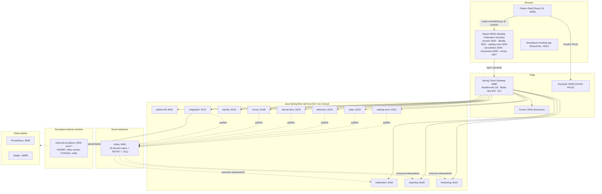
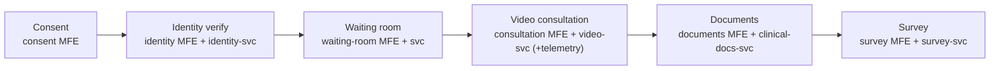
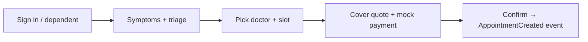

# Telemedicine Patient — Architecture (HLD + LLD) & Flows

Current state of the repo. Grounded in the code, configs, and the verified
`Features.md` / `Skills.md`. Diagrams are Mermaid.

## 1. High-Level Design (HLD)



**Request landing (how a call flows):** Browser → Patient Shell → MFE remote
→ dev server proxies `/api/*` → Gateway (:8080) validates the Keycloak JWT,
applies circuit breaker + rate limit, resolves the target via Consul (`lb://`)
→ BFF or domain service. Writes that matter to other services are published as
Kafka domain events; notification / monitoring / reporting consume them
idempotently. External calls (HIS/MPI/FONASA/video vendor) go through
`integration-service` to the simulators.

## 2. Low-Level Design (LLD) — consultation slice

```mermaid
sequenceDiagram
  participant U as Patient (browser)
  participant S as Shell / consultation MFE
  participant G as Gateway :8080
  participant KC as Keycloak
  participant B as patient-bff :8091
  participant V as video-service :8103
  participant T as telemetry-service :8104
  participant K as Kafka
  participant M as monitoring-service

  U->>KC: OAuth2 Authorization Code + PKCE
  KC-->>U: access token (JWT)
  U->>S: open /patient/consultation
  S->>G: GET /api/v1/video/.../session (Bearer JWT)
  G->>G: validate JWT · CB · rate-limit · lb://
  G->>V: route via Consul
  V-->>G: session + token payload
  G-->>S: 200 session
  S->>G: GET /api/v1/telemetry/... (if flag + consent)
  G->>T: route
  V-->>K: publish VideoSessionStarted
  K-->>M: consume (idempotent) → monitoring projection
  Note over S,V: chat via video/chat adapter; media via video vendor (simulated)
```

**Key LLD facts (from code):**
- Shared libs `java-common-*` provide core/web/security/events/persistence/observability.
- Events use `@DomainEventListener` + `@IdempotentConsumer`; each topic has
  `.RETRY` and `.DLQ` siblings (see `infra/kafka/topics.txt`).
- `EventPublisher.publish(EventTypes.X, payload)` is async (`whenComplete`).
- Gateway routes are config-driven (`gateway/.../application.yml`), every route
  has a Resilience4j circuit breaker with `forward:/fallback`.

## 3. Journey flow diagrams (brief)

### 3.1 Live consultation journey (Module Federation path)


Each step hits the gateway → BFF/domain service; state changes emit Kafka
events (e.g. `PatientEnteredWaitingRoom`, `VideoSessionStarted`,
`ClinicalDocumentIssued`, `SurveyRequested`) consumed by notification/monitoring/reporting.

### 3.2 Booking funnel (standalone demo path)


`patient-booking` (:3001) is a separate React/Vite app (not an MFE); its dev
mock is `patient-booking-api`. `patient-booking-service` publishes
`AppointmentCreated` / `StatusChanged`. `video-consultation-service` (:8130)
provides peer-to-peer WebRTC signaling for this path and is not wired into the
gateway or compose.

## 4. What is what (quick legend)

| Layer | Tech | Examples |
|-------|------|----------|
| Microfrontends | React 18 + Vite + Module Federation | shell + 6 patient MFEs |
| Edge | Spring Cloud Gateway | :8080, JWT, CB, rate-limit |
| Discovery / auth | Consul / Keycloak | :8500 / :8180 |
| Services | Java 21 + Spring Boot 3.3.5 | BFF + 11 domain services |
| Async | Kafka | 28 domain events + RETRY + DLQ |
| External (sim) | external-simulators | :8200 /sim/** |
| Observability | Prometheus + Jaeger | :9090 / :16686 |
