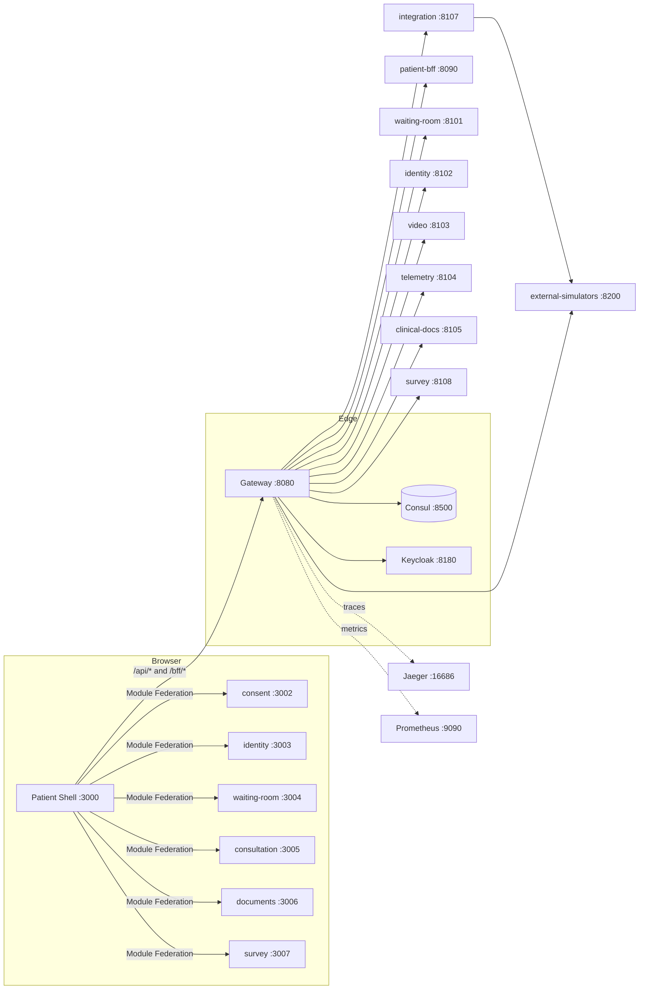

# Telemedicine Patient — Features

A functional overview of the patient-facing telemedicine platform: what it does, the
end-to-end patient journey, and a feature catalog that ties each capability to the
frontend app/route and the backend service/BFF/endpoint that implement it.

This document describes the `telemedicinePatient` mono-workspace, which contains three
sub-repos:

- `telemedicine-backend` — Spring Cloud Gateway, Consul service discovery, Java (Spring Boot 3.3.5 / Java 21) domain + platform services, three BFFs, and an external-systems simulator.
- `telemedicine-frontend` — Nx + pnpm monorepo of React 18 shells and Module Federation microfrontends (MFEs), plus reusable packages.
- `telemedicine-platform` — Docker Compose, Kubernetes, and CI that wire everything together.

> Scope note: this catalog focuses on the **patient** experience. The repo also ships
> physician and admin shells/MFEs and supporting backend services; those are listed where
> relevant but not described in depth.

---

## What the product does

The platform delivers a remote medical consultation to a patient entirely in the browser:
the patient gives consent, verifies their identity, waits in a virtual queue, joins a video
consultation with chat (and optional vital-sign telemetry), then retrieves clinical
documents and completes a satisfaction survey. A separate, self-contained **booking**
application covers the pre-booking funnel (sign-in, symptoms, triage, doctor/slot selection,
payment, confirmation, and appointment management).

Everything a patient touches goes through a single API entry point — the **gateway** on
`:8080` — which discovers backend services through **Consul**, protecting them with rate
limiting, circuit breakers, and (in non-dev mode) Keycloak-issued JWTs.

---

## End-to-end patient journey

The consultation journey is a strict, gated state machine. The shared journey model lives in
`packages/shared-types/src/types/journey.ts` (`JourneyStatus` / `JourneyStep` and the
ordered `JOURNEY_STATUS_ORDER`). Each MFE calls `useJourneyGate(...)` from
`@telemedicine/session-context` and refuses to render until the required status is reached.

```
LINK_GENERATED → CONSENT_GRANTED → IDENTITY_VALIDATED → DEVICE_TEST_COMPLETED
   → OPEN_PATIENT → CHECKED_IN → OPEN_DOCTOR → IN_CONSULTATION
   → CONSULTATION_CLOSED → SURVEY_COMPLETED
```

Mapped to the shell routes and the gate each MFE enforces:

| Step | Shell route | MFE (port) | Journey gate (requires) | Advances status to |
|------|-------------|------------|--------------------------|--------------------|
| Consent | `/patient/consent` | `mfe-patient-consent` (3002) | `LINK_GENERATED` | `CONSENT_GRANTED` |
| Identity | `/patient/identity` | `mfe-patient-identity` (3003) | `CONSENT_GRANTED` | `IDENTITY_VALIDATED` |
| Waiting room | `/patient/waiting-room` | `mfe-patient-waiting-room` (3004) | `IDENTITY_VALIDATED` | `OPEN_DOCTOR` / `IN_CONSULTATION` |
| Consultation | `/patient/consultation` | `mfe-patient-consultation` (3005) | `OPEN_DOCTOR` | `CONSULTATION_CLOSED` |
| Documents | `/patient/documents` | `mfe-patient-documents` (3006) | `CONSULTATION_CLOSED` | — |
| Survey | `/patient/survey` | `mfe-patient-survey` (3007) | `CONSULTATION_CLOSED` | `SURVEY_COMPLETED` |

The patient **shell** (`apps/shell`, `:3000`) is the Module Federation host. It reads
`apps/shell/public/config/mfe-manifest.json`, filters remotes by the user's roles
(`PATIENT`) and by config-service feature flags, then lazy-loads each remote's `./App` for
its route. The shell hydrates journey state from the patient BFF on load
(`hydrateFromBff(appointmentId)`).

---

## Feature catalog by domain

### 1. Consent

- **What it does:** Collects platform consent (terms, data processing) and clinical consent,
  shows current consent status, and supports withdrawal. Consent text is defined in
  `packages/consent-kit/src/consent-text.ts`; required platform items must all be accepted
  before continuing. Granting platform consent sets journey status `CONSENT_GRANTED`;
  granting clinical consent routes forward to identity.
- **Frontend:** `mfe-patient-consent` at `/patient/consent` (`:3002`), using
  `@telemedicine/consent-kit` (`PlatformConsent`, `ClinicalConsent`, `ConsentWithdrawal`,
  `useConsent`).
- **Backend:** Consent is managed by the **waiting-room-service** (`:8101`) behind the
  gateway route `/api/v1/waiting-room/**`; the patient BFF aggregates journey/consent state.

### 2. Identity verification

- **What it does:** A two-step verification. The patient submits a document (type `RUT` or
  `PASSPORT`) to start a challenge, then enters an OTP to verify. The UI enforces a 3-attempt
  limit and locks out after too many failures. On success it stores patient name / insurance
  plan metadata and advances to `IDENTITY_VALIDATED`.
- **Frontend:** `mfe-patient-identity` at `/patient/identity` (`:3003`); calls
  `POST /v1/identity/validate` and `POST /v1/identity/verify` via `@telemedicine/api-client`.
- **Backend:** **identity-service** (`:8102`), gateway route `/api/v1/identity/**`. It
  performs FONASA 2FA through the **integration-service** anti-corruption layer, which in
  turn talks to the **external-simulators** (e.g. FONASA/MPI). Source confirms a real
  implementation: `IdentityController`, `FonasaChallenge*`, `IntegrationServiceClient`,
  JPA entities/repositories.

### 3. Waiting room

- **What it does:** Polls the patient's queue position and estimated wait, surfaces a
  payment-pending state, and provides a **device test** panel (camera/mic/speaker/bandwidth
  preflight). It watches for the physician opening the session and then navigates the patient
  into the consultation.
- **Frontend:** `mfe-patient-waiting-room` at `/patient/waiting-room` (`:3004`); polls
  `GET /v1/waiting-room/queue/{appointmentId}` (every 5 s) and
  `GET /v1/video/appointments/{appointmentId}/session`; embeds
  `DeviceTestPanel` from `@telemedicine/device-test`.
- **Backend:** **waiting-room-service** (`:8101`, `/api/v1/waiting-room/**`) for the queue,
  and **video-service** (`:8103`, `/api/v1/video/**`) to detect a live session.

### 4. Video consultation

- **What it does:** Joins a live video session with the physician, exposes audio/video mute
  toggles, a session timer, live network-quality indicator, and a real-time chat panel. When
  the telemetry feature flag is on and consent is granted, it embeds vital-sign telemetry
  (ANURA) behind consent/config gates. Leaving the consultation sets `CONSULTATION_CLOSED`
  and routes to documents.
- **Frontend:** `mfe-patient-consultation` at `/patient/consultation` (`:3005`). Uses
  `@telemedicine/video-adapter` (`useVideoSession`), `@telemedicine/chat-adapter`
  (`useChat`), and `@telemedicine/telemetry-adapter`
  (`TelemetryConsentGate` / `TelemetryConfigGate` / `TelemetryEmbed`), gated by
  `@telemedicine/feature-flags` (`ConfigKeys.TELEMETRY_ENABLED`).
- **Backend:** **video-service** (`:8103`, `/api/v1/video/**`) for sessions, tokens, and chat
  persistence; **telemetry-service** (`:8104`, `/api/v1/telemetry/**`) is an independently
  deployable service for ANURA telemetry.

### 5. Documents

- **What it does:** Lists post-consultation clinical artifacts — consultation summaries,
  prescriptions, and medical-leave certificates — with issue dates and status, polling every
  10 s until documents are ready, and offers secure downloads (opens `downloadUrl` in a new
  tab). It falls back from `/documents` to the base document endpoint if needed.
- **Frontend:** `mfe-patient-documents` at `/patient/documents` (`:3006`); calls
  `GET /v1/clinical-docs/{appointmentId}/documents`.
- **Backend:** **clinical-docs-service** (`:8105`, `/api/v1/clinical-docs/**`). It generates
  PDF documents / prescriptions (via RecMed/Medipass simulators) and stores them in MinIO.

### 6. Survey

- **What it does:** Presents a post-consultation satisfaction survey, defaulting to an NPS
  (0–10) question plus optional free-text comments; supports submit or skip, is idempotent on
  submit, and shows a thank-you page. Submitting sets `SURVEY_COMPLETED`.
- **Frontend:** `mfe-patient-survey` at `/patient/survey` (`:3007`); calls
  `GET /v1/survey/{appointmentId}` and `POST /v1/survey/{appointmentId}/responses` (with an
  idempotency key).
- **Backend:** **survey-service** (`:8108`, `/api/v1/survey/**`), which dispatches surveys
  after a consultation closes and captures NPS.

### 7. Booking (standalone pre-consultation funnel)

- **What it does:** A full, standalone appointment-booking and self-service app covering ~39
  screens (`p01`–`p39`): front door, sign-in (email/password or ClaveÚnica), who-needs-care
  (self or dependent), reason/symptoms with red-flag detection, medical history, triage,
  doctor list and slot selection, cover/cost quote, review, mock payment, confirmation, home,
  past consultations, consent centre, help, cancel, follow-up flows, consultation-link entry,
  and consent withdrawal.
- **Frontend:** `apps/patient-booking` — a **separate** React 18 + Vite app on `:3001` (not a
  Module Federation remote of the patient shell). It uses a local wizard/state machine
  (`src/shared/wizard`, `src/shared/state`) and the workspace package
  `@telemedicine/video-conference`. It proxies `/api` to `http://localhost:8120`.
- **Backend (dev):** `apps/patient-booking-api` — a small Express mock API (`:4000` by
  default via `PORT`) that serves sign-in, patients, symptoms extraction, triage, doctors +
  slots, cover quote, appointments, and consents. It is a development mock, not a production
  Spring service.

> Relationship note: `patient-booking` + `patient-booking-api` form a self-contained demo of
> the booking funnel. The six Module Federation patient MFEs above cover the live
> consultation journey backed by the real Spring services through the gateway. They are
> wired independently.

---

## Backend platform capabilities

### Gateway routing (`gateway`, `:8080`)

Spring Cloud Gateway is the single public entry point
(`telemedicine-backend/gateway/src/main/resources/application.yml`). It uses Consul
`lb://` routing, a Redis-backed request rate limiter, named Resilience4j circuit breakers per
route with an RFC 9457 `/fallback`, and CORS for the shells (`:3000`, `:3010`, `:3020`).

| Route predicate | Target service |
|-----------------|----------------|
| `/bff/patient/**` | patient-bff |
| `/bff/physician/**` | physician-bff |
| `/bff/admin/**` | admin-bff |
| `/api/v1/waiting-room/**` | waiting-room-service |
| `/api/v1/identity/**` | identity-service |
| `/api/v1/video/**` | video-service |
| `/api/v1/telemetry/**` | telemetry-service |
| `/api/v1/clinical-docs/**` | clinical-docs-service |
| `/api/v1/notifications/**` | notification-service |
| `/v1/appointments/v2/**` | integration-service |
| `/api/v1/integration/**` | integration-service (webhooks) |
| `/api/v1/survey/**` | survey-service |
| `/api/v1/reporting/**` | reporting-service |
| `/api/v1/monitoring/**` | monitoring-service |
| `/api/v1/config/**` | config-service |
| `/api/v1/audit/**` | audit-service |
| `/api/v1/scheduler/**` | scheduler-service |
| `/sim/**` | external-simulators |

### Service discovery (Consul, `:8500`)

Every service registers with Consul and is reached by logical name through the gateway's
`lb://` URIs. Health is checked at `/actuator/health`; Prometheus scrapes via the registered
`metrics-path` tag.

### Authentication (Keycloak, `:8180`)

Keycloak hosts the `telemedicine` realm. The gateway validates JWTs via the realm JWK set
(`telemedicine.security.jwt.jwk-set-uri`). Security mode is `DEV` by default locally, which
relaxes enforcement for local development.

### Observability (Prometheus `:9090`, Jaeger `:16686`)

Services expose `health`, `info`, and `prometheus` actuator endpoints, emit OTLP traces to
Jaeger (`OTEL_EXPORTER_OTLP_ENDPOINT`), and are scraped by Prometheus.

### External integrations & simulators

- **integration-service** (`:8107`) is an anti-corruption layer exposing
  `/v1/appointments/v2/**` and `/api/v1/integration/**` (webhooks). It adapts external
  systems — HIS, SAP, payment, FONASA, MPI, Zendesk — behind a stable internal contract.
- **external-simulators** (`:8200`, `/sim/**`) stands in for those external vendors with a
  stateful `SimulatorEngine` (per-vendor latency/jitter/error injection), an admin API
  (`/sim/admin`), and stateful stores (appointment lifecycle, FONASA lockout, video sessions,
  notify log). A `SimulatorSafetyGuard` blocks it from starting in production profiles.

### Backends-for-Frontends (BFFs)

Aggregation-only facades with no persistence or business logic:

| BFF | Port | Route | Purpose |
|-----|------|-------|---------|
| patient-bff | 8090 | `/bff/patient/**` | Aggregates the patient journey (`GET /bff/patient/journey/{appointmentId}`) for the shell |
| physician-bff | 8091 | `/bff/physician/**` | Physician views |
| admin-bff | 8092 | `/bff/admin/**` | Config, KPI, audit facades |

### Complete backend service inventory

Domain services (profile `domain`, ports 8101–8110):

| Service | Port | Gateway route |
|---------|------|---------------|
| waiting-room-service | 8101 | `/api/v1/waiting-room/**` |
| identity-service | 8102 | `/api/v1/identity/**` |
| video-service | 8103 | `/api/v1/video/**` |
| telemetry-service | 8104 | `/api/v1/telemetry/**` |
| clinical-docs-service | 8105 | `/api/v1/clinical-docs/**` |
| notification-service | 8106 | `/api/v1/notifications/**` |
| integration-service | 8107 | `/v1/appointments/v2/**`, `/api/v1/integration/**` |
| survey-service | 8108 | `/api/v1/survey/**` |
| reporting-service | 8109 | `/api/v1/reporting/**` |
| monitoring-service | 8110 | `/api/v1/monitoring/**` |
| patient-booking-service | — | registered in Gradle; not published in `docker-compose.yml` |

Platform services (profile `platform`):

| Service | Port | Gateway route |
|---------|------|---------------|
| audit-service | 8111 | `/api/v1/audit/**` |
| config-service | 8112 | `/api/v1/config/**` |
| scheduler-service | 8113 | `/api/v1/scheduler/**` |

Edge + simulators: gateway (8080), external-simulators (8200). Templates
(`services/_template-java`, `services/_template-python`) are scaffolding, built only under the
`apps` compose profile.

> Note: `patient-booking-service` is included in `settings.gradle` but has no service
> definition in `telemedicine-platform/docker-compose.yml`; treat it as present in the
> backend build but not part of the default compose stack.

---

## Cross-cutting frontend features (packages)

Reusable libraries under `telemedicine-frontend/packages` provide the shared capabilities the
MFEs compose:

| Package | Capability |
|---------|-----------|
| `auth` | OAuth2 **PKCE** against Keycloak (`createPkceChallenge`, S256), silent token refresh, `RequireAuth` / `RequireRole` guards, and a dev bypass (`devMode`) that mints a `PATIENT` dev user |
| `video-adapter` | Provider-abstracted video with **Vonage**, **ACS**, and **Simulator** adapters, selected by the `VIDEO_PROVIDER` feature flag (defaults to simulator) |
| `chat-adapter` | Clinical chat with API persistence (`useChat`) |
| `telemetry-adapter` | ANURA vital-sign embed behind consent + config gates |
| `consent-kit` | Platform + clinical consent flows with withdrawal and consent text catalog |
| `device-test` | Camera / mic / speaker / bandwidth preflight |
| `i18n` | **es-CL** and **en** locale bundles with Intl formatters (`formatDate`, `formatCurrency`, etc.) |
| `feature-flags` | config-service client with safe defaults when the service is unreachable |
| `session-context` | Cross-MFE journey state, BFF hydration, and journey gate logic |
| `mfe-registry` | RBAC-aware manifest loading, config-driven enablement, remote load retry/fallback |
| `api-client` | Typed HTTP client with auth header, correlation IDs, retry/backoff, and ProblemDetail normalization |
| `shared-types` | OpenAPI-aligned DTOs, `ProblemDetail`, `ErrorCode`, journey/event/config types |
| `design-system` | **WCAG 2.1 AA** themed component library (patient + clinical themes), with Storybook |
| `shared-ui` | Backward-compat re-exports from design-system |
| `observability-web` | Error boundary, web-vitals, journey timing, rate-limited error reporting |
| `telemetry-adapter`, `video-conference` | `video-conference` is used by the standalone `patient-booking` app |
| `test-utils` | `renderWithProviders`, MSW handlers, fixtures, mock adapters |
| `eslint-config`, `tsconfig-presets` | Shared lint and TypeScript config |

---

## Architecture diagram



Standalone booking app (separate from the shell): `patient-booking :3001` → `/api` →
`patient-booking-api` (Express mock, `:4000`).
